# Agentic Pipeline & Multi-Skill Workflow Specification (`30_design/workflow.md`)

> **Phase:** P3 (`30_design/`)
> **Status:** Locked Specification
> **Governed By:** `D-001`, `D-008`, `D-009`, `D-010`, `D-011`, `D-012`, `D-013`, `D-015`, `PAT-AI-001`
> **Knowledge Coverage:** 63/63 `accepted` Knowledge Cards in [`20_knowledge/INDEX.md`](../knowledge/INDEX.md)

---

## 1. Purpose & Design Philosophy

The **Data Story Slide Deck** pipeline prevents the core failure mode of standard AI presentation generators: jumping straight from raw inputs to finished slides (`ANTI-AI-001`), which flattens `Narrative Tension` (`ANTI-STR-001`), hallucinates stakeholder priorities (`PRIN-AI-003`), and outputs overloaded rainbow charts (`ANTI-VIS-001`, `ANTI-DSN-001`).

Instead, our architecture operates in the **Middle Zones of Human–AI Collaboration** (`PRIN-AI-001`):
1. **Stateful Stage-Gated Progression (`D-001`, `D-010`):** The pipeline pauses at four explicit `Checkpoint Gates` (`G1`, `G2`, `G3`, `G4`), writing validated artifacts to disk so context never lives solely in ephemeral chat history.
2. **Decision-Tree Frontier Grilling (`D-001`, `D-009`):** Agents read all uploaded documents and tabular datasets first, then interview the user in rounds of **at most 4 unblocked `Frontier Questions`**, each paired with a concrete **Recommended Answer**.
3. **Format-Agnostic Upstream Planning (`D-008`):** Checkpoints `G1` through `G3` produce a single canonical `Slide Spec` (`slide_spec.yaml`). Downstream `Renderers` compile `slide_spec.yaml` into native editable PowerPoint (`.pptx`) or interactive web slides (`.html`) plus rendered slide PNGs (`renders/slide_*.png`) for visual inspection at `G4`.
4. **Scoped Knowledge Injection (`PAT-AI-001`):** Rather than dumping all accepted cards into every prompt, each of the 7 skills loads only the exact `accepted` `Knowledge Cards` required for its stage.

---

## 2. End-to-End Pipeline Architecture & Workspace Layout

### 2.1 Pipeline Flow Diagram (`G1` → `G2` → `G3` → `G4`)

```mermaid
flowchart TD
    subgraph Inputs["User Inputs (D-012)"]
        RAW_DOC["Raw Reports / Docs (PDF, DOCX, MD, TXT)"]
        RAW_DATA["Tabular Datasets (CSV, XLSX)"]
    end

    ORCH["1. deck-orchestrator<br/>(State Machine & Routing)"]
    Inputs --> ORCH

    subgraph Stage1["Stage 1: Context & Big Idea"]
        CG["2. deck-context-griller<br/>(<=4 Frontier Qs + Recommendations)"]
        G1{{"Checkpoint Gate G1 (Mandatory)<br/>Artifact: context_brief.md<br/>Audit: CHK-REV-001 Part A (G1.1–G1.6)"}}
        CG --> G1
    end

    subgraph Stage2["Stage 2: Storyboarding & Horizontal Logic"]
        SB["3. deck-storyline-builder<br/>(Prune Artifacts, Narrative Arc, 2-Pass Titles)"]
        G2{{"Checkpoint Gate G2 (Mandatory)<br/>Artifact: storyline.md<br/>Audit: CHK-REV-001 Part B (G2.1–G2.6)"}}
        SB --> G2
    end

    subgraph Stage3["Stage 3: Visual Selection & Layout Plan"]
        VP["4. deck-visual-planner<br/>(2–3 Chart Options, Shows vs. Obscures)"]
        G3{{"Checkpoint Gate G3 (Lightweight Table Approval)<br/>Artifact: storyline.md (G3 Visual Plan Table)<br/>+ Draft slide_spec.yaml Skeleton"}}
        VP --> G3
    end

    subgraph Stage4["Stage 4: Slide Build, Render & Adversarial Review"]
        DB["5. deck-builder<br/>(7 Word Jobs, Greyscale Baseline, Color Tie)"]
        SPEC["Artifact: slide_spec.yaml<br/>(Format-Agnostic Contract)"]
        REND["Downstream Renderers (40_plugin/scripts/)<br/>Native Editable .pptx / Interactive .html + PNGs"]
        DR["6. deck-reviewer<br/>(Subtraction-First Audit + Anticipated Questions)"]
        DF["7. deck-finisher<br/>(Finish Pass: layout fields only, D-091)"]
        G4{{"Checkpoint Gate G4 (Mandatory)<br/>Artifacts: review_report_g4.md + renders/*.png<br/>Audit: CHK-REV-002 (G4.1–G4.15)"}}
        DB --> SPEC --> REND --> DR --> DF --> G4
    end

    ORCH --> CG
    G1 -- "User Approves G1" --> SB
    G2 -- "User Approves G2" --> VP
    G3 -- "User Selects Visuals" --> DB
    G4 -- "Revisions Needed" --> DB
    G4 -- "Storyline Drift" --> SB
    G4 -- "User Approves Final Deck" --> OUT["Final Deliverable:<br/>deck.pptx / deck.html + Executive Q&A Prep"]
```



### 2.2 Target User Deck Workspace Structure

When a user initiates a presentation project (always created outside this repository or inside an isolated eval run folder per `D-014`), `deck-orchestrator` maintains the following deterministic workspace directory:

```text
<user-deck-workspace>/
├── inputs/
│   ├── source_report.md            # Uploaded reports, memos, notes (PDF, DOCX, MD, TXT)
│   └── dataset.csv                 # Optional verified source tables (CSV, XLSX)
├── artifacts/
│   ├── context_brief.md            # G1 stateful artifact (conforms to context_brief.schema.md)
│   ├── storyline.md                # G2/G3 stateful artifact (conforms to storyline.schema.md)
│   ├── slide_spec.yaml             # G3/G4 canonical build spec (conforms to slide_spec.schema.yaml)
│   └── review_report_g4.md         # G4 adversarial audit & skeptic Q&A report
├── renders/
│   ├── slide_01.png                # Rendered slide images for G4 visual geometry inspection
│   ├── slide_02.png
│   └── ...
└── output/
    ├── presentation.pptx           # Native editable PowerPoint deck (primary MVP target)
    └── presentation.html           # Interactive HTML deck (secondary target)
```

---

## 3. Checkpoint Gate Protocol & Frontier Grilling Rules

### 3.1 Frontier Interviewing Protocol (`D-001`, `D-009`, `PRIN-AI-002`, `PRIN-AI-003`)
1. **Zero Redundant Fact-Asking:** Before asking any question, the active skill must parse `inputs/` and extract all explicit metrics, dates, sample sizes, and stated context. Never ask the user what can be read from files.
2. **At Most 4 Unblocked `Frontier Questions` Per Round:** Group questions by dependency. Only ask top-level decision questions whose prerequisites are settled.
3. **Mandatory Recommended Answers:** Every `Frontier Question` must include a concrete `[Recommended: ...]` option synthesized from the input documents so the user can approve with a single confirmation.
4. **Anti-Sycophancy & Constructive Challenge (`PRIN-AI-002`):** If the user proposes bundled actions (`ANTI-CTX-001`), chronological analyst agendas (`ANTI-STR-001`), descriptive topic headers (`ANTI-TTL-001`), or overloaded combo charts (`ANTI-VIS-001`), the agent must politely explain the cognitive trade-off and recommend the SWD-compliant alternative.
5. **Immediate Disk Persistence (`D-001`):** Every user answer or gate approval is written to `artifacts/context_brief.md`, `artifacts/storyline.md`, or `artifacts/slide_spec.yaml` immediately.

### 3.2 Gate State Machine (`G1` → `G4`)

| Gate | Controlling Skill | Artifact Written | Gate Type | Pre-Gate Self-Audit | Exit Condition to Advance |
|---|---|---|---|---|---|
| **`G1` Context Brief** | `deck-context-griller` | `artifacts/context_brief.md` | **Mandatory Stop** | `CHK-REV-001` Part A (`G1.1`–`G1.6`) | All 6 `G1` checks pass AND user explicitly approves `status: approved`. |
| **`G2` Storyline & Titles** | `deck-storyline-builder` | `artifacts/storyline.md` (Sections 1–4) | **Mandatory Stop** | `CHK-REV-001` Part B (`G2.1`–`G2.6`) | All 6 `G2` checks pass (`Horizontal Logic` verified) AND user approves `status: approved`. |
| **`G3` Visual & Layout Plan** | `deck-visual-planner` | `artifacts/storyline.md` (Section 5 `G3` Table) | **Lightweight Table Approval** | `PRIN-VIS-001..003`, `PAT-VIS-001..002`, `ANTI-VIS-001..002` | User confirms or adjusts the selected visual option per slide in the `G3` trade-off table. |
| **`G4` Adversarial Review** | `deck-reviewer` | `artifacts/review_report_g4.md` + updated `slide_spec.yaml` + `renders/*.png` | **Mandatory Stop** | `CHK-REV-002` (`G4.1`–`G4.15`) + `CHK-REV-001` drift check | Zero failed `G4` checks on both `slide_spec.yaml` and rendered `.png` slides, reported as machine checks, agent review and human decision; only the owner's explicit words accept G4 (`D-035`). |

### 3.3 Rollback & Repair Routing
- **Visual / Layout / Word-Job Defect at `G4` (`G4.1`–`G4.7`, `G4.10`–`G4.11`):** `deck-reviewer` routes specific slide IDs and repair instructions back to `deck-builder`, which patches `slide_spec.yaml` and re-runs the `Renderer` until the affected slide PNGs pass.
- **Claim-vs-Evidence Mismatch or Narrative Drift at `G4` (`G4.8`, `G4.9`, or `CHK-REV-001` regression):**
  - If a `Takeaway Title` overclaims what the plotted metric measures (`G4.8`), `deck-builder` either updates the `Takeaway Title` to match the measured metric (re-verifying `Horizontal Logic`) or switches the plotted metric if verified source data exists.
  - If the slide sequence itself breaks `Horizontal Logic`, `deck-orchestrator` rolls back to `deck-storyline-builder` (`G2`).

---

## 4. Six-Skill Responsibilities & Exact Knowledge Card Bindings (`63/63` Cards)

To enforce `PAT-AI-001` (*Inject Explicit SWD Principles Across a Five-Stage Gated Workflow*) without bloating prompt context, each skill in `40_plugin/skills/` binds to a deterministic subset of the **63 `accepted` Knowledge Cards** in `20_knowledge/`.

### 4.1 Master Card-to-Skill Binding Matrix (100% Coverage of All 63 Accepted Cards)

| Stage | Card ID | Card Title | `deck-orchestrator` | `deck-context-griller` (`G1`) | `deck-storyline-builder` (`G2`) | `deck-visual-planner` (`G3`) | `deck-builder` (`G3`→`G4`) | `deck-reviewer` (`G4`) |
|---|---|---|:-:|:-:|:-:|:-:|:-:|:-:|
| AI | `ANTI-AI-001` | Unguided End-to-End Deck Generation and Borrowed Conviction | **X** | **X** |  |  |  |  |
| AI | `ANTI-AI-002` | Allowing AI Scope Inflation to Expand Topics Instead of Narrowing Focus | **X** | **X** | **X** |  |  | **X** |
| CTX | `ANTI-CTX-001` | Bundling Multiple Sequential Actions and Using Generic Stakes |  | **X** |  |  |  |  |
| DSN | `ANTI-DSN-001` | Using Rainbow Software Defaults and Competing Dark Secondary Series |  |  |  |  | **X** | **X** |
| DSN | `ANTI-DSN-002` | Slide-Level Decorative Noise — Repeated Logos, Filler Imagery, and Boxes With Both Fill and Outline |  |  |  |  | **X** | **X** |
| STR | `ANTI-STR-001` | Defaulting to Chronological Analyst Flow and Letting AI Flatten Tension |  |  | **X** |  |  |  |
| TTL | `ANTI-TTL-001` | Mistaking Polished Chart Narration for an Actionable Takeaway Title |  |  | **X** |  |  | **X** |
| TTL | `ANTI-TTL-002` | Swinging Between Repetitive Text Overload and Bare Over-Minimalism |  |  |  |  | **X** | **X** |
| VIS | `ANTI-VIS-001` | Overloaded Combo Charts and Multi-Dimensional Stacked Bars |  |  |  | **X** |  | **X** |
| VIS | `ANTI-VIS-002` | Falling for AI Novelty Bias and Inserting Static Raster Chart Images |  |  |  | **X** | **X** | **X** |
| REV | `CHK-REV-001` | Checkpoint G1 (Context Brief) and G2 (Storyline & Horizontal Logic) Gate Checklist | **X** | **X** | **X** |  |  | **X** |
| REV | `CHK-REV-002` | Checkpoint G4 Slide Hierarchy, Visual Emphasis, and Claim-vs-Evidence Audit Checklist | **X** |  |  |  |  | **X** |
| REV | `EX-001` | End-to-End Case Study: Nurse Staffing Model Change (Context → Story → Visual → Design) | **X** | **X** | **X** | **X** | **X** | **X** |
| VIS | `EX-002` | Worked Example: Decomposing Multi-Dimensional Stacked Bars Into a 1+4 Small Multiples Grid |  |  |  | **X** | **X** | **X** |
| DSN | `EX-003` | Worked Example: Two-Tier Color Intensity (Menu Sales Change) and Delivery-Mode Paired Views (Staffing Shortfall) |  |  |  | **X** | **X** | **X** |
| TTL | `EX-004` | Worked Example: Transforming Chart Narration Into Actionable Insight With the Seven Word Jobs |  |  | **X** |  | **X** | **X** |
| TTL | `LANG-EN` | English Slide Typography and Takeaway Title Rules | **X** | **X** | **X** |  | **X** | **X** |
| TTL | `LANG-VI` | Vietnamese Slide Typography and Takeaway Title Rules | **X** | **X** | **X** |  | **X** | **X** |
| AI | `PAT-AI-001` | Inject Explicit SWD Principles Across a Five-Stage Gated Workflow | **X** | **X** | **X** | **X** | **X** | **X** |
| CTX | `PAT-CTX-001` | Big Idea Worksheet Grilling Pattern at Checkpoint G1 |  | **X** |  |  |  |  |
| CTX | `PAT-CTX-002` | Use Directional Phrasing in the Big Idea When Exact Estimates Invite Premature Nitpicking |  | **X** |  |  |  |  |
| DSN | `PAT-DSN-001` | Choose Between One-Sided and Two-Sided Layouts Based on Visual Pairing |  |  |  | **X** | **X** |  |
| DSN | `PAT-DSN-002` | Use Two-Tier Color Intensity and Shaded Deltas to Guide Focus |  |  |  |  | **X** | **X** |
| DSN | `PAT-DSN-003` | Guardrails for Non-Uniform Y-Axis Scales Across Small Multiples |  |  |  | **X** | **X** | **X** |
| DSN | `PAT-DSN-004` | Keep Each Entity's Colour Constant Across the Deck |  |  |  | **X** | **X** | **X** |
| DSN | `PAT-DSN-005` | Keep Chart Text Horizontal — Shorten, Wrap, or Re-Chart Instead of Rotating Labels |  |  |  | **X** | **X** | **X** |
| PRS | `PAT-PRS-001` | Use Progressive Reveal and Visual Scaffolding in Live Presentations |  |  |  | **X** | **X** | **X** |
| STR | `PAT-STR-001` | Withhold the Overarching Conclusion Until Rising-Action Evidence Lands |  |  | **X** |  |  |  |
| STR | `PAT-STR-002` | Consolidate Split Arguments to Preserve Pre-Climax Momentum |  |  | **X** |  |  |  |
| STR | `PAT-STR-003` | Close on a Decision Summary Slide That Stays Up During Discussion, Not a "Thank You" Slide |  |  | **X** |  |  | **X** |
| TTL | `PAT-TTL-001` | Two-Pass Takeaway Title Compression to Eliminate AI Verbosity |  |  | **X** |  | **X** |  |
| VIS | `PAT-VIS-001` | Prototype 2–3 Visual Options With Explicit Trade-Offs at Checkpoint G3 |  |  |  | **X** |  |  |
| VIS | `PAT-VIS-002` | Unpack Multi-Dimensional Data Into Small Multiples or a 1+4 Hierarchical Grid |  |  |  | **X** | **X** |  |
| AI | `PRIN-AI-001` | Operate in the Middle Zones of Human-AI Collaboration and Keep the Human in the Driver's Seat | **X** | **X** |  |  |  |  |
| AI | `PRIN-AI-002` | Challenge Assumptions Constructively and Ask Clarifying Questions Before Critiquing | **X** | **X** | **X** | **X** |  | **X** |
| AI | `PRIN-AI-003` | Maintain Strict Factual Grounding and Separate Facts From Inferences | **X** | **X** | **X** |  | **X** | **X** |
| CTX | `PRIN-CTX-001` | Shift From Exploratory Analysis to Explanatory Communication |  | **X** |  |  |  |  |
| CTX | `PRIN-CTX-002` | Map Specific Stakeholders, Priorities, and Biases Beyond Generic Labels |  | **X** |  |  |  |  |
| CTX | `PRIN-CTX-003` | Anchor the Presentation on a Single, Realistic Primary Action |  | **X** |  |  |  |  |
| CTX | `PRIN-CTX-004` | Reframe Operational Metrics Into Audience-Specific Strategic Stakes |  | **X** |  |  |  |  |
| CTX | `PRIN-CTX-005` | The Big Idea Must Be a Single Sentence With Point of View and Stakes |  | **X** |  |  |  |  |
| DSN | `PRIN-DSN-001` | Enforce Vertical Logic and Anchor Upper-Left Z-Pattern Scanning |  |  |  | **X** | **X** | **X** |
| DSN | `PRIN-DSN-002` | Override Software Defaults and Declutter Deliberately Without Stripping Essential Context |  |  |  |  | **X** | **X** |
| DSN | `PRIN-DSN-003` | Enforce Crisp Grid Alignment and Establish Brand Identity Upfront |  |  |  |  | **X** | **X** |
| DSN | `PRIN-DSN-004` | Start With a Greyscale Baseline and Apply Accessible Focus Color Sparingly |  |  |  |  | **X** | **X** |
| DSN | `PRIN-DSN-005` | Set Text Legibility Floors by Text Role and Delivery Mode, Not by One Universal Minimum |  |  |  |  | **X** | **X** |
| DSN | `PRIN-DSN-006` | Keep Palettes Distinguishable in Greyscale and for Colour-Vision Deficiency |  |  |  |  | **X** | **X** |
| DSN | `PRIN-DSN-007` | Contrast Floors by Visual Role and Delivery Mode |  |  |  |  | **X** | **X** |
| DSN | `PRIN-DSN-008` | Use Few, Clearly Different Type Levels and Spend Bold and Capitals as a Limited Emphasis Budget |  |  |  |  | **X** | **X** |
| DSN | `PRIN-DSN-009` | Choose a Typeface That Fits Data Slides — Normal Width and Weight, Lining Tabular Figures, Full Glyph Coverage |  | **X** |  |  | **X** | **X** |
| PRS | `PRIN-PRS-001` | Adapt Text Density and Slide Layout to Delivery Mode ("Will You Be There?") |  | **X** |  | **X** | **X** | **X** |
| STR | `PRIN-STR-001` | Plan With Low-Fidelity Storyboarding Before Opening Slide Software |  |  | **X** |  |  |  |
| STR | `PRIN-STR-002` | Ruthlessly Prune Analyst-Process Artifacts From the Storyboard |  |  | **X** |  |  |  |
| STR | `PRIN-STR-003` | Structure Content Around the Narrative Arc and Audience Tension |  |  | **X** |  |  |  |
| STR | `PRIN-STR-004` | Enforce Horizontal Logic Across Sequential Takeaway Titles |  |  | **X** |  |  | **X** |
| TTL | `PRIN-TTL-001` | Articulate the Single Highest-Priority Takeaway Before Designing the Visual |  |  | **X** | **X** |  |  |
| TTL | `PRIN-TTL-002` | Pair a Point-of-View Takeaway Title With a Neutral Descriptive Chart Title |  |  |  |  | **X** | **X** |
| TTL | `PRIN-TTL-003` | Assign Every Text Element to One of the Seven Functional Word Jobs |  |  |  |  | **X** | **X** |
| VIS | `PRIN-VIS-001` | Let the Finalized Takeaway Title Drive the Visual Form |  |  |  | **X** |  |  |
| VIS | `PRIN-VIS-002` | Default to the Six Familiar Workhorse Charts |  |  |  | **X** | **X** |  |
| VIS | `PRIN-VIS-003` | Give Each Analytical Question Its Own Dedicated View |  |  | **X** | **X** |  |  |
| VIS | `PRIN-VIS-004` | Start Bar Value Axes at Zero and Never Crop Line Axes to Exaggerate Change |  |  |  | **X** | **X** | **X** |
| VIS | `PRIN-VIS-005` | Choose the Colour Scale From the Data Type and the Message |  |  |  | **X** | **X** |  |

---

### 4.2 Detailed Specification per Skill

#### Skill 1: `deck-orchestrator` (`40_plugin/skills/deck-orchestrator/SKILL.md`)
- **Role:** Entry-point controller and stateful workflow router.
- **Inputs:** User request, `inputs/*`, and existing workspace artifacts (`artifacts/*`).
- **Execution Logic:**
  1. Inspect `<user-deck-workspace>/artifacts/` to determine the current pipeline stage.
  2. Never allow skipping a mandatory `Checkpoint Gate` (`G1`, `G2`, `G4`) (`ANTI-AI-001`).
  3. Route execution to `deck-context-griller` (if `context_brief.md` is missing or `draft`), `deck-storyline-builder` (after `G1` approval), `deck-visual-planner` (after `G2` approval), `deck-builder` (after `G3` table confirmation), or `deck-reviewer` (after `slide_spec.yaml` and `renders/*.png` are built).
  4. Load only the target language card (`LANG-EN` or `LANG-VI`) into downstream skills based on `deck_language` locked in `context_brief.md` (`D-011`).

#### Skill 2: `deck-context-griller` (`40_plugin/skills/deck-context-griller/SKILL.md`)
- **Role:** Discovery interviewer and `Checkpoint G1` gatekeeper.
- **Inputs:** `inputs/*` (raw reports, memos, CSV/XLSX datasets).
- **Outputs:** `artifacts/context_brief.md` conforming to [`context_brief.schema.md`](./context_brief.schema.md).
- **Execution Logic:**
  1. Digest all uploaded files and extract verifiable metrics, scope, and candidate tensions (`PRIN-AI-003`).
  2. Run the `Big Idea` Worksheet grilling loop (`PAT-CTX-001`): ask at most 4 unblocked `Frontier Questions` per round with `[Recommended]` defaults (`D-009`) to lock:
     - Specific `Audience` decomposition: primary decision-maker, allies/champions, and skeptics/veto-holders (`PRIN-CTX-002`).
     - A single realistic `Primary Action` for this meeting plus optional fallback concession (`PRIN-CTX-003`, `ANTI-CTX-001`).
     - Dual-sided strategic `Stakes`: concrete benefits of acting vs. concrete risks of inaction (`PRIN-CTX-004`).
     - Single-sentence `Big Idea` using directional phrasing when exact model figures invite premature methodology nitpicking (`PRIN-CTX-005`, `PAT-CTX-002`).
     - `Delivery Mode` (`live`, `standalone`, `hybrid`), target format (`pptx` or `html`), `deck_language`, and brand palette (`PRIN-PRS-001`, `D-008`, `D-011`).
  3. Execute `CHK-REV-001` Part A (`G1.1`–`G1.6`) self-audit, write `artifacts/context_brief.md`, and pause for mandatory user `G1` approval.

#### Skill 3: `deck-storyline-builder` (`40_plugin/skills/deck-storyline-builder/SKILL.md`)
- **Role:** Low-fi storyboard architect, `Horizontal Logic` enforcer, and `Checkpoint G2` gatekeeper.
- **Inputs:** Approved `artifacts/context_brief.md` + `inputs/*`.
- **Outputs:** `artifacts/storyline.md` (Sections 1–4) conforming to [`storyline.schema.md`](./storyline.schema.md).
- **Execution Logic:**
  1. **Prune Analyst Artifacts (`PRIN-STR-002`, `ANTI-AI-002`):** Explicitly log and strip data-cleaning history, chronological project steps, rejected exploratory breakdowns, and non-decisive slices (moving backup tables to `appendix_candidates`).
  2. **Architect the `Narrative Arc` (`PRIN-STR-003`, `PAT-STR-001`, `PAT-STR-002`, `ANTI-STR-001`):**
     - Map slides to `Plot`, `Rising Action`, `Climax`, `Falling Action`, and `Resolution` (or 3-part `Story Mountain` for $\le 5$-slide decks).
     - Sequence rising-action evidence *before* any overarching indictment of the status quo when skeptics exist (`PAT-STR-001`).
     - Consolidate split multi-slide arguments (`PAT-STR-002`) so momentum builds cleanly into a dual or single `Climax` (human + financial peak) and, only when skeptics are mapped, dedicated objection-reframe slides in `Falling Action` (`D-035`).
  3. **Author & Compress `Takeaway Titles` (`PRIN-TTL-001`, `PAT-TTL-001`, `ANTI-TTL-001`, `LANG-*`):**
     - Execute two-pass compression (`draft_1_verbose` $\rightarrow$ `pass_2_compressed`) so every slide headline is Sentence case, active voice, answers *"So what?"*, avoids passive chart narration, and obeys hard token limits (`LANG-EN` $\le 12$ words; `LANG-VI` $\le 20$ syllables).
  4. **Verify `Horizontal Logic` (`PRIN-STR-004`) & Run `CHK-REV-001` Part B (`G2.1`–`G2.6`):** Present the clean `Horizontal Logic` title list to the user and pause for mandatory `G2` approval.

#### Skill 4: `deck-visual-planner` (`40_plugin/skills/deck-visual-planner/SKILL.md`)
- **Role:** Visual form selector, trade-off prototyper, and `Checkpoint G3` planner.
- **Inputs:** Approved `artifacts/context_brief.md`, approved `artifacts/storyline.md`, and `inputs/*`.
- **Outputs:** Section 5 (`Checkpoint G3` Visual & Layout Plan Table) appended to `artifacts/storyline.md`; `deck-builder` creates `artifacts/slide_spec.yaml` after G3 approval (`D-040`).
- **Execution Logic:**
  1. Let each slide's finalized `Takeaway Title` and `analytical_question` drive its visual form (`PRIN-VIS-001`, `PRIN-VIS-003`).
  2. Default to the **Six Workhorse Charts** (`line_chart`, `vertical_bar_chart`, `horizontal_bar_chart`, `stacked_bar_chart`, `slopegraph`, `dot_plot` — `PRIN-VIS-002`) and forbid novelty charts or static raster images (`ANTI-VIS-002`).
  3. Decompose overloaded combo charts or multi-dimensional stacked bars (`ANTI-VIS-001`) into paired views (`Two-Sided Layout` — `PAT-DSN-001`, `EX-003`), `Small Multiples`, or a `1_plus_4_grid` (`PAT-VIS-002`, `EX-002`).
  4. For every data slide, prototype **2–3 candidate visual options** with explicit trade-offs (`shows` vs. `obscures` — `PAT-VIS-001`), highlight the recommended option, and present the lightweight `G3` table for user confirmation.

#### Skill 5: `deck-builder` (`40_plugin/skills/deck-builder/SKILL.md`)
- **Role:** Full `Slide Spec` compiler and `Renderer` invoker.
- **Inputs:** Confirmed `G3` visual plan in `artifacts/storyline.md`, `artifacts/context_brief.md`, and verified datasets in `inputs/*`.
- **Outputs:** Complete `artifacts/slide_spec.yaml` (conforming to [`slide_spec.schema.yaml`](./slide_spec.schema.yaml)), compiled `output/presentation.pptx` (or `.html`), and rendered slide images `renders/slide_*.png`.
- **Execution Logic:**
  1. **Enforce `Vertical Logic` & Upper-Left Z-Anchor (`PRIN-DSN-001`, `PRIN-DSN-003`):** Position every slide's `Takeaway Title` at the top-left, paired with a neutral `Descriptive Chart Title` (`PRIN-TTL-002`) and explicit `Axis Titles`.
  2. **Assign All 7 Functional Word Jobs (`PRIN-TTL-003`, `ANTI-TTL-002`, `EX-004`):** Populate `takeaway_title`, `chart_title`, `axis_titles`, `direct_labels`, `annotations`, `recommendation_callout`, and `source_footnote` with zero triple-headline repetition.
  3. **Apply `Greyscale Baseline`, Two-Tier Color & `Color Tie` (`PRIN-DSN-004`, `PAT-DSN-002`, `ANTI-DSN-001`, `EX-003`):** Format all context series in muted grey (`1.5pt`), apply accessible single-hue two-tier accent color (`primary_focal` `3.0–3.5pt` + `secondary_tint`) to the focal series/bars and `shaded_deltas`, and link key words in titles/callouts via `color_tie_spans`.
  4. **Enforce Decluttering & `Small Multiples` Scale Guardrails (`PRIN-DSN-002`, `PAT-DSN-003`, `EX-002`):** Strip chart borders, minor gridlines, tick marks, trailing `.00` decimals, and detached legends; use solid lines for actuals and dashed lines for forecasts; enforce shared `[min, max]` y-axes across `Small Multiples` (or apply the `min_max_only` + `direct_endpoint_labels` guardrail when subgroup variance $>4\times$).
  5. **Configure `Delivery Mode` & `Progressive Reveal` (`PRIN-PRS-001`, `PAT-PRS-001`):** Add self-sufficient annotations for `standalone` decks or step-by-step `reveal_steps[]` with `speaker_notes` for `live` decks.
  6. Invoke the target `Renderer` in `40_plugin/scripts/` to generate the editable `.pptx` (or `.html`) and export `renders/slide_*.png` for `deck-reviewer`.

#### Skill 6: `deck-reviewer` (`40_plugin/skills/deck-reviewer/SKILL.md`)
- **Role:** Adversarial subtraction-first auditor and `Checkpoint G4` gatekeeper.
- **Inputs:** `artifacts/context_brief.md`, `artifacts/storyline.md`, `artifacts/slide_spec.yaml`, and rendered slide PNGs (`renders/slide_*.png`).
- **Outputs:** `artifacts/review_report_g4.md` and pass/repair routing at `Checkpoint G4`.
- **Execution Logic:**
  1. **Pre-Flight `G1`/`G2` Drift Verification (`CHK-REV-001`):** Confirm that `slide_spec.yaml` preserves the approved `Big Idea`, `Primary Action`, and `Horizontal Logic`.
  2. **Execute the 15-Point `CHK-REV-002` Review (`G4.1`–`G4.15`) Across Every Slide:**
     - *Part A (`G4.1`–`G4.3` — Message Hierarchy):* Flag any triple-headline repetition, missing dual titles/axis titles, or detached legends.
     - *Part B (`G4.4`–`G4.7` — Visual Emphasis & Decluttering):* Flag any leftover chart chrome, competing dark navy/black secondary lines, red-green color pairs, missing `Color Tie`, or unguarded non-uniform `Small Multiples` axes.
     - *Part C (`G4.8`–`G4.9` — Claim-vs-Evidence & Factual Grounding):* Verify that the noun/verb in every `Takeaway Title` strictly matches what the y-axis metric measures (zero causal leaps) and that 100% of numbers trace to `inputs/`.
     - *Part D (`G4.10`–`G4.12` — Rendered PNG Visual QA & Anticipated Questions):* Inspect `renders/slide_*.png` for text clipping, label overlap, grid misalignment, or orphan Vietnamese compound words (`LANG-VI`), and prepare 2–3 anticipated audience questions with evidence-backed answers (in the report or notes, not new slides). *Part E (`G4.13`–`G4.15`):* prominence matches importance, every slide serves a recorded audience need, and the tone is neutral (`D-035`).
  3. If any check fails, trigger automatic repair via `deck-builder` and re-verify before presenting the clean `G4 Review Report` and final deck to the user.

#### Skill 7: `deck-finisher` (`40_plugin/skills/deck-finisher/SKILL.md`, `D-091`)
- **Role:** Design-layer finish pass between the agent review (`agent_review_complete`) and the owner's G4 decision.
- **Inputs:** `artifacts/slide_spec.yaml`, `renders/slide_*.png`, `contracts/design_system.md`.
- **Outputs:** `finish` blocks in `slide_spec.yaml`, `g4_review_audit.finish.content_digest`, the "Finish" section of `review_report_g4.md`, and before/after renders.
- **Execution Logic:** record the content digest (`deckctl.py digest`); score each render 0-3 on reading order, grouping, rhythm, hierarchy, white space and consistency; run the design checks (`D-090`); set only `title_break_after`, `diagram_height_in`, `chart_height_in` or `side_card_cols`; rebuild. `validate_spec.py` fails the pass if any content changed; a content problem goes back to `deck-builder`.

---

## 5. End-to-End Paper Walkthrough Verification (`Task P3.4` — Reference Case `EX-001`)

To validate that `context_brief.schema.md`, `storyline.schema.md`, and `slide_spec.schema.yaml` have no structural gaps across `G1` → `G2` → `G3` → `G4`, we trace the canonical **`EX-001` Nurse Staffing Model Change** scenario end-to-end. It is a fictional scenario (`D-017`); the complete, machine-validated artifacts are generated from `50_evals/scenarios/bench_en_nurse_staffing.yaml` into `50_evals/runs/bench_en_nurse_staffing/`.

### Step 1: Raw Input Ingestion → `deck-context-griller` (`Checkpoint G1`)
- **Input Files:** `inputs/source_report.md` (workforce review notes: rotation policy, competency assessments, turnover, agency spend, weekend coverage) + `inputs/nurse_outcomes.csv`, `throughput.csv`, `savings.csv`, `weekend.csv`.
- **Frontier Grilling Round (`<= 4` Questions with Recommendations):**
  1. *Q1 (Stakeholder Map — `G1.2`):* Who decides, and who are the skeptics in the room? → `[Recommended: Decision by the CEO and Executive Leadership Team; Dr. Lena Okafor (CNO) as champion; map Tomás Reyes (CFO, expects rotation to hold agency spend down), Hana Sato (VP Workforce Planning, designed the rotation), and Victor Mensah (Director of Operations, worried about weekend coverage).]`
  2. *Q2 (Unbundled Primary Action — `G1.3`):* Your notes mention alignment, buy-in, and either a full change or a pilot. What single decision is requested today? → `[Recommended: Approve replacing the uniform monthly rotation with unit-based staffing from next quarter; keep a six-month pilot in two units only as the fallback.]`
  3. *Q3 (Big Idea Phrasing — `G1.5`):* State the modeled $4.3M in the Big Idea, or use directional phrasing to avoid an early debate with the CFO? → `[Recommended: Directional ("meaningfully cut agency and turnover costs"); show the $4.3M breakdown on Slide 5 after the turnover evidence.]`
  4. *Q4 (Delivery & Format Metadata — `G1.6`):* → `[Recommended: delivery_mode: live, target_format: pptx, deck_language: en.]`
- **Artifact Produced:** `artifacts/context_brief.md` passes `G1.1`–`G1.6` and carries the `G1` approval stamp (`D-021`).

### Step 2: `context_brief.md` → `deck-storyline-builder` (`Checkpoint G2`)
- **Pruning (`G2.1`):** parking badge-in counts and shift-swap app logs excluded; survey methodology moved to the appendix.
- **`Narrative Arc` & `Horizontal Logic` (`G2.2`–`G2.6`):** 7 slides — `Plot` (Slide 1), `Rising Action` (Slide 2 outpatient throughput), `Climax` (Slide 3 competency drop + Slide 4 first-year turnover), `Falling Action` (Slide 5 $4.3M savings for the CFO, held until after the evidence per `PAT-STR-001`; Slide 6 weekend coverage for Operations), and `Resolution` (Slide 7 single ask, with planned cross-training answering the policy's designer).
- **Two-Pass Title Compression (`G2.6` — `LANG-EN`):**
  - Slide 3 Pass 1 (24 words): *"When we compare competency assessments before and after the rotation policy, new-graduate nurses declined in every unit while experienced nurses held steady."*
  - Slide 3 Pass 2 (9 words): *"Competency scores fell for new-graduate nurses after rotation began."*
- **Artifact Produced:** `artifacts/storyline.md` passes `G2.1`–`G2.6`.

### Step 3: `storyline.md` → `deck-visual-planner` (`Checkpoint G3`)
- **Trade-Off Prototyping (`PAT-VIS-001`) for Slides 3 and 4:**
  - *Option A (Rejected):* 18-bar grouped column chart — *Shows:* every unit-cohort value; *Obscures:* the before/after trajectory under heavy clutter.
  - *Option B (Rejected):* diverging bars of net change — *Shows:* the change; *Obscures:* absolute score levels (`3.9` vs. `3.2`), and adds an unfamiliar-chart learning tax (`ANTI-VIS-002`).
  - *Option C (Selected):* `small_multiples_grid` of three slopegraphs (one per unit: *Critical Care*, *Emergency*, *Outpatient*; lines for *New graduate*, *Experienced*, *Senior*) — *Shows:* the steep new-graduate drop against flat grey cohorts; reused on Slide 4 so the audience learns the grammar once.

### Step 4: `deck-builder` → `deck-reviewer` (`Checkpoint G4`)
- **Compilation (`slide_spec.yaml`):** Slide 3 uses `layout_type: small_multiples_grid`, `chart_family: slopegraph`, `shared_y_axis: true` (`[2.5, 5.0]`, format `"0.0"`), `Greyscale Baseline` (delivery-mode context grey, `1.5pt`) for *Experienced* and *Senior*, accessible orange `#D95F02` (`3.25pt`) for *New graduate*, a `Color Tie` on `"new-graduate nurses"`, and all 7 `word_jobs`. Every plotted value is resolved from `inputs/nurse_outcomes.csv` by the validator.
- **Review (`CHK-REV-002` `G4.1`–`G4.15`):**
  - `G4.1` (No Triple-Headline Repetition): no subtitle or callout repeats the `Takeaway Title`.
  - `G4.5` (Zero Competing Dark Series): *Senior* is muted grey, not dark navy.
  - `G4.8` (Strict Claim-vs-Evidence Match): the title claims *competency scores*, exactly what the y-axis plots — not an unmeasured "support gap".
  - `G4.12` (Anticipated Questions): Q&A prepared for the CFO (agency spend, Slides 5–6) and the VP Workforce Planning (cross-training, Slides 3 and 7).
- **Result:** All `CHK-REV-001` and `CHK-REV-002` checks are representable and verifiable across the three contracts.
