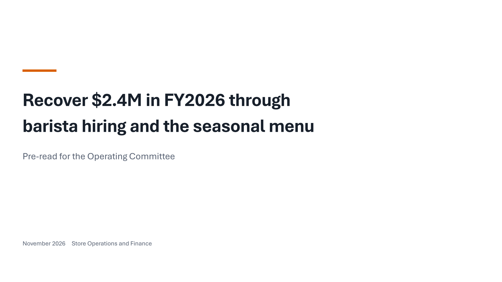

# Data Story Slide Deck

Agent skills that turn a report and its data into a clear, story-driven slide deck. The output is a PowerPoint file with **native, editable charts**, plus an HTML version. The skills follow the *storytelling with data* (SWD) approach and stop at four checkpoints where a person approves the work. Every number on a chart is checked against your input files.

> **Audience note:** this file is for people. AI coding agents working on this repository start at [`AGENTS.md`](./AGENTS.md).

---

## How it works

```text
your report + data
      │
      ▼
 G1  Context      who decides, what they must do, the one-sentence Big Idea      → context_brief.md
 G2  Storyline    narrative arc and one takeaway title per slide                 → storyline.md
 G3  Visual plan  2–3 chart options per slide, with what each shows and hides    → visual plan in storyline.md
 G4  Build+review compile slide_spec.yaml → .pptx + .html, render, review,       → output/ and renders/
                  finish pass, then your decision
```

1. **You decide; the agent drafts.** The agent never invents audience context. It asks you, at most four questions per round, each with a recommended answer.
2. **Process before pixels.** Each gate writes a file you approve. A later stage refuses to run on an unapproved or changed earlier file.
3. **Editable output.** Charts are native PowerPoint charts you can restyle and whose data you can edit, not pictures.
4. **Checked numbers.** Each plotted value points to a cell or a line in your inputs. The validator compares them before anything is built.
5. **Works on any computer.** System fonts (Aptos, with Arial as the fallback) and five colour kits tested for colour blindness, greyscale print and projectors. Brand themes and custom fonts are left to you.

Seven skills do the work:

| Skill | Gate | Job |
|---|---|---|
| `deck-orchestrator` | — | Entry point: reads the workspace and sends you to the right stage |
| `deck-context-griller` | G1 | Interviews you and writes the context brief |
| `deck-storyline-builder` | G2 | Orders the slides and writes the takeaway titles |
| `deck-visual-planner` | G3 | Picks a chart for each title |
| `deck-builder` | → G4 | Compiles the slide spec into `.pptx` and `.html` and renders QA images |
| `deck-reviewer` | G4 | Reviews the rendered slides against the checklist and your data |
| `deck-finisher` | G4 | Adjusts layout only (line breaks, heights) after looking at the renders |

---

## Quickstart

You need Python 3.10 or later. Microsoft PowerPoint or LibreOffice is optional; it turns the `.pptx` into QA images. Full details, commands and options are in [`40_plugin/README.md`](./40_plugin/README.md).

**Claude Code**
```bash
claude plugin marketplace add trongtrd/data-story-slide-deck
claude plugin install data-story-slide-deck@data-story-slide-deck
```
On first use, the skills tell you if the Python environment is missing and how to create it.

**Codex, Antigravity, ZCode** (from a clone of this repository)
```bash
git clone https://github.com/trongtrd/data-story-slide-deck.git
cd data-story-slide-deck
python 40_plugin/install.py                      # Codex and Antigravity, user scope
python 40_plugin/install.py --target zcode       # ZCode
```
The installer creates a private environment in `~/.data-story-slide-deck`, copies the skills where each agent looks for them, and runs a smoke build. `--uninstall` removes only what it created.

**Then** put your report and data in a folder and ask your agent to use `deck-orchestrator` on it.

---

## Gallery

These slides come from the benchmark decks in [`50_evals/runs/`](./50_evals/runs/). Their scenarios, companies and numbers are invented. The Editorial showcase is rendered in PowerPoint; the other benchmarks are rendered in LibreOffice so that CI compares like with like on every operating system.

| | |
|---|---|
|  |  |
| **Title slide** (Editorial design) | **Gap over time beside its breakdown** |
|  |  |
| **Payoff and effort side by side**, with the decision | **Heatmap table** |
|  |  |
| **Strip plot**: every store as a dot | **Small multiples** on a shared scale |
|  |  |
| **Stacked bars** in the Blue colour kit | **Vietnamese deck**: diverging stacks with side totals |

---

## Limitations

This is version 0.1.0. What has and has not been tested:

- **Tested:** the evaluation suite and a clean install pass in CI on Ubuntu, Windows and macOS (Python 3.12). On Windows 11 with PowerPoint 16, six decks were opened, edited, saved, reopened and exported, with 37 of 37 native charts intact.
- **Not yet tested:** PowerPoint on macOS (including QA rendering through it), projection on a real projector, Excel's chart-data window, and a real `claude plugin install` on a clean profile. Codex has not yet been confirmed to discover the skills.
- **Agent runs so far:** three decks were built end to end from a real survey report, two on Antigravity and one on ZCode. On the project's 20-point review rubric they scored 9 and 11 (Antigravity, before and after fixes) and 15 (ZCode). The deck still needs your review at G4.
- **HTML is secondary.** PPTX is the main output. The HTML deck keeps the data and text, but its typography is checked less strictly.
- **Languages:** title and typography rules exist for English and Vietnamese only.
- **QA images:** LibreOffice renders can differ slightly from what PowerPoint shows. Without either program, decks still build, but you check the `.pptx` yourself.
- **Thresholds:** some numbers in the rules (for example the title length limit) are project heuristics, not SWD rules.

---

## Evaluation

[`50_evals/README.md`](./50_evals/README.md) explains the benchmarks, the 100-point rubric, and how to run the checks:

```bash
python -m pip install -r requirements.txt
python 50_evals/scripts/run_eval_suite.py
python 50_evals/scripts/test_review_regressions.py
```

---

## Repository structure

```text
data-story-slide-deck/
├── README.md, AGENTS.md       # for people / for AI agents (CLAUDE.md and GEMINI.md point to AGENTS.md)
├── 00_admin/                  # status, roadmap, backlog, decision log, conventions
├── 10_sources/SOURCES.md      # registry of the sources studied (notes and copies stay private)
├── 20_knowledge/              # 82 knowledge cards: principles, patterns, anti-patterns, checklists, examples, language rules
├── 30_design/                 # workflow and artifact schemas (the source of 40_plugin/contracts)
├── 40_plugin/                 # the product: skills, scripts, installer, bundled contracts and cards
└── 50_evals/                  # benchmark scenarios, runs, rubric, reports, and test scripts
```

Edit `20_knowledge/` and `30_design/`, not their copies in `40_plugin/`; `50_evals/scripts/sync_plugin_resources.py` updates the copies.

---

## License and attribution

Code is Apache-2.0 ([`LICENSE`](./LICENSE)). Knowledge cards, skills, contracts, documentation and examples are CC BY 4.0 ([`LICENSE-CONTENT`](./LICENSE-CONTENT)).

The approach builds on the books, posts and *SWD + AI Primer* by **Cole Nussbaumer Knaflic** and the **storytelling with data** team ([storytellingwithdata.com](https://www.storytellingwithdata.com/)), with secondary sources credited in [`NOTICE`](./NOTICE). The cards and skills are written in this project's own words; no source text, images or PDFs are distributed. This project is not affiliated with or endorsed by storytelling with data.
