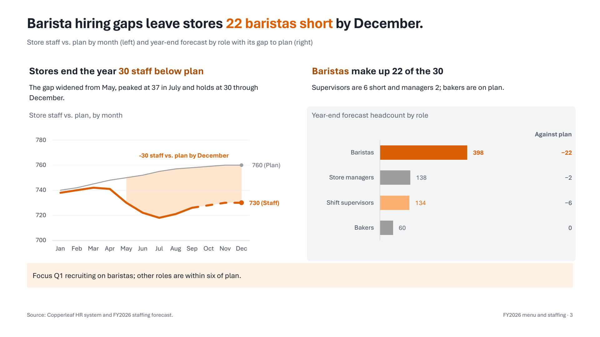
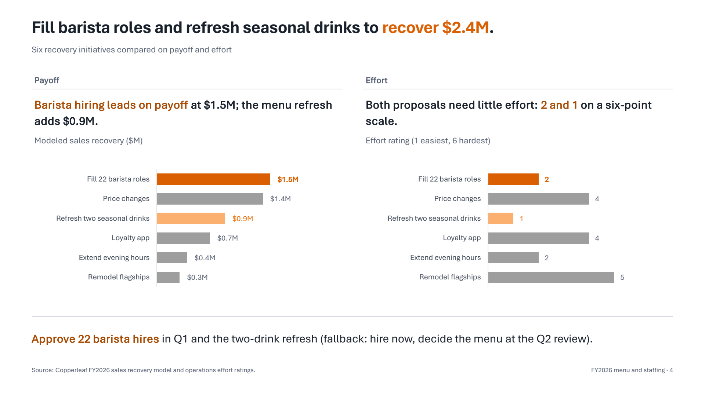
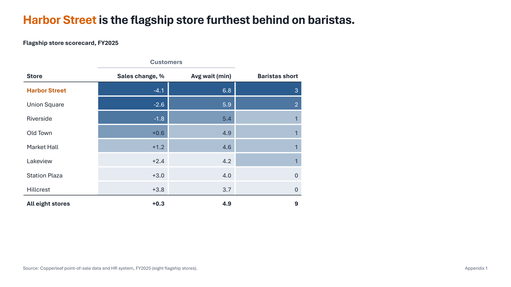
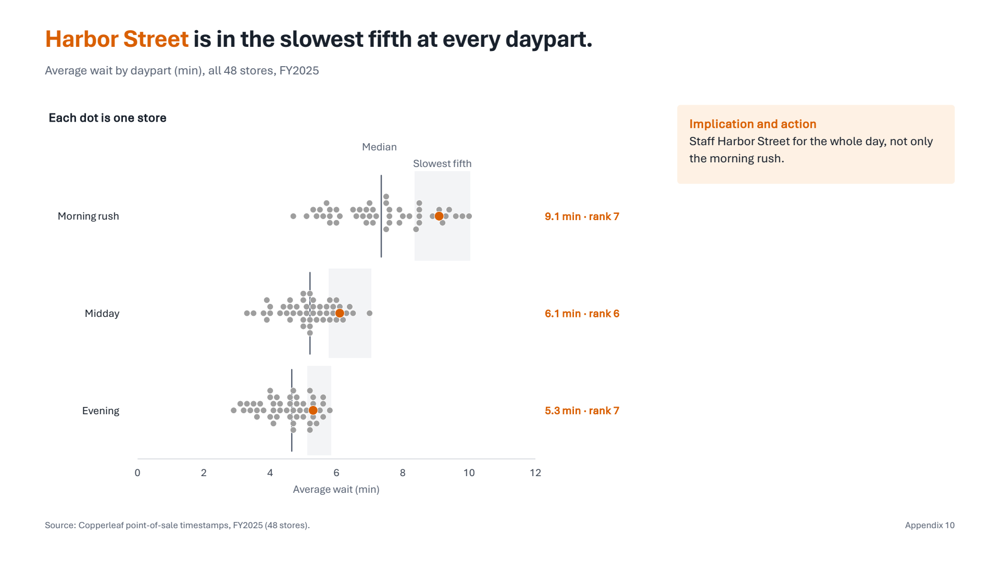
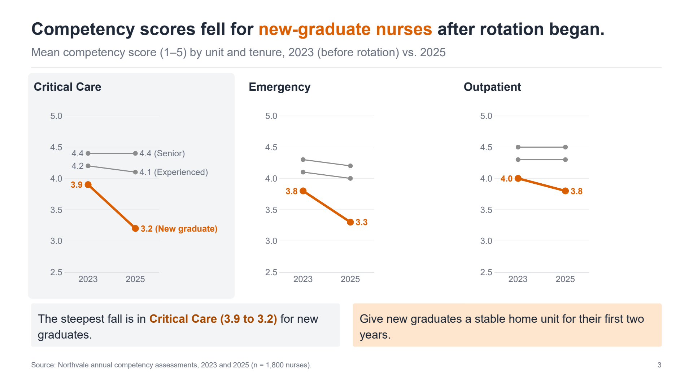
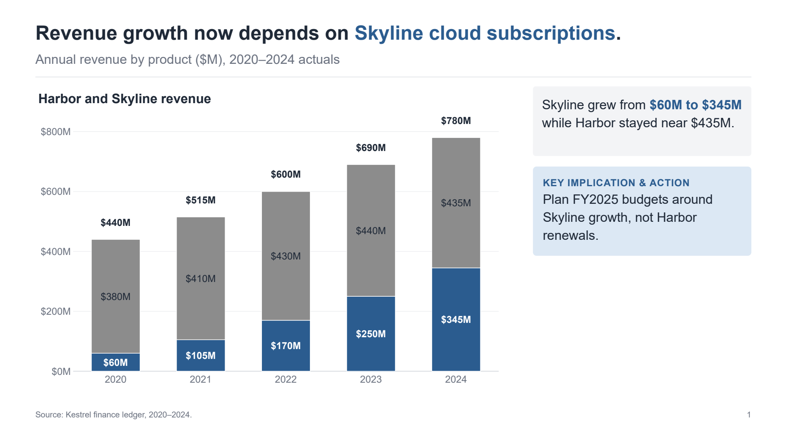
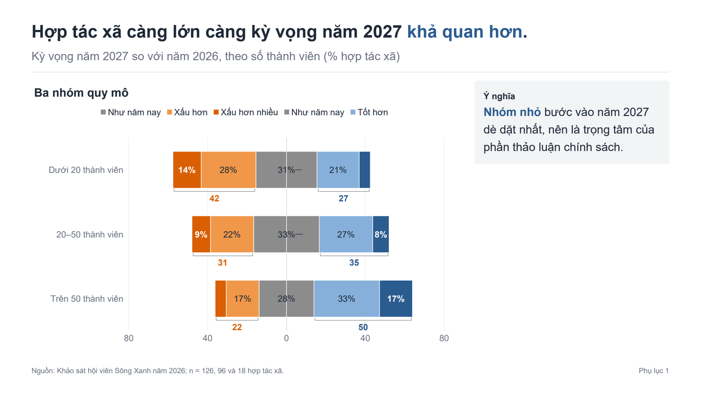
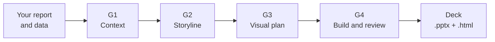

<p align="center">
  
</p>

# Data Story Slide Deck

**From a report and its data to a story-driven slide deck you can still edit.**

[](https://github.com/trongtrd/data-story-slide-deck/actions/workflows/ci.yml) [](https://github.com/trongtrd/data-story-slide-deck/releases) [](#license-and-attribution)

Seven agent skills with installers for Claude Code, Codex, Antigravity and ZCode. They follow the *storytelling with data* (SWD) approach and stop at four checkpoints where you approve the work. The output is a PowerPoint file with **native, editable charts**, plus an HTML version. Every number on a chart is checked against your input files.

> [!NOTE]
> **Pre-release (`v0.1.0-rc1`).** Not yet tested: the Claude Code install on a clean profile, Codex skill discovery, PowerPoint on macOS, projection on a real projector, and Excel's chart-data window. What has been tested is listed in [Status and limitations](./40_plugin/README.md#status-and-limitations).

[Quickstart](#quickstart) · [Gallery](#gallery) · [How it works](#how-it-works) · [Is this for you?](#is-this-for-you) · [Evaluation](#evaluation)

---

## Quickstart

You need Python 3.10 or later. Microsoft PowerPoint or LibreOffice is optional; it turns the `.pptx` into QA images. Full details and options are in [`40_plugin/README.md`](./40_plugin/README.md).

**Claude Code** (the install path has not yet been tested on a clean profile; see the note above)

```bash
claude plugin marketplace add trongtrd/data-story-slide-deck
claude plugin install data-story-slide-deck@data-story-slide-deck
```

On first use, the skills tell you if the Python environment is missing and how to create it.

**Codex, Antigravity, ZCode** (from a clone of this repository)

```bash
git clone https://github.com/trongtrd/data-story-slide-deck.git
cd data-story-slide-deck
python 40_plugin/install.py                      # Codex and Antigravity, user scope
python 40_plugin/install.py --target zcode       # ZCode
```

The installer creates a private environment in `~/.data-story-slide-deck`, copies the skills where each agent looks for them, and runs a smoke build. `--uninstall` removes only what it created.

**Then** put your report and data in one folder and ask your agent:

```text
Use the deck-orchestrator skill on the folder ./my-report. My report and data are in it.
```

---

## What you get

- **A `.pptx` deck** whose charts are native PowerPoint charts: you can restyle them and edit their data.
- **An `.html` version** of the same deck. It is secondary: PPTX is the main output.
- **Approval records.** `context_brief.md` (G1) and `storyline.md` with its visual plan (G2, G3) are stamped with your approval; `slide_spec.yaml` is the build spec the deck is compiled from, and G4 adds a review report.
- **Checked numbers.** Each plotted value points to a cell or a line in your inputs, and the validator compares them before anything is built.
- **QA images** of the finished slides, rendered from the real `.pptx`, so you and the reviewer skill look at the same thing.

---

## Gallery

These slides come from the benchmark decks in [`50_evals/runs/`](./50_evals/runs/). Their scenarios, companies and numbers are invented. The Editorial showcase is rendered in PowerPoint; the other benchmarks are rendered in LibreOffice so that CI compares like with like on every operating system.

<table>
  <tr>
    <td width="50%"><br><b>Payoff and effort side by side</b>, with the decision</td>
    <td width="50%"><br><b>Heatmap table</b></td>
  </tr>
  <tr>
    <td width="50%"><br><b>Strip plot</b>: every store as a dot</td>
    <td width="50%"><br><b>Small multiples</b> on a shared scale</td>
  </tr>
  <tr>
    <td width="50%"><br><b>Stacked bars</b> in the Blue colour kit</td>
    <td width="50%"><br><b>Vietnamese deck</b>: diverging stacks with side totals</td>
  </tr>
</table>

---

## How it works



| Gate | What you approve | File |
|---|---|---|
| **G1 Context** | Who decides, what they must do, the one-sentence Big Idea | `context_brief.md` |
| **G2 Storyline** | The narrative arc and one takeaway title per slide | `storyline.md` |
| **G3 Visual plan** | 2–3 chart options per slide, with what each shows and hides | visual plan in `storyline.md`, plus a draft `slide_spec.yaml` |
| **G4 Build and review** | The deck compiled from `slide_spec.yaml`, rendered, reviewed and given a finish pass, then your decision | `output/`, `renders/` and `review_report_g4.md` |

Four principles run through every stage:

1. **You decide; the agent drafts.** The agent never invents audience context. It asks you, at most four questions per round, each with a recommended answer.
2. **Process before pixels.** A later stage refuses to run on an unapproved or changed earlier file.
3. **Editable output.** Charts are native PowerPoint charts, not pictures.
4. **Works on any computer.** System fonts (Aptos, with Arial as the fallback) and five colour kits tested for colour blindness, greyscale print and projectors. Brand themes and custom fonts are left to you.

The seven skills: `deck-orchestrator` (entry point), `deck-context-griller` (G1), `deck-storyline-builder` (G2), `deck-visual-planner` (G3), `deck-builder` (compiles and renders), `deck-reviewer` and `deck-finisher` (G4). Each skill's job is in [`40_plugin/README.md`](./40_plugin/README.md).

---

## Is this for you?

| Your situation | Use it? | Why |
|---|---|---|
| You have a report and its data and need a deck for a decision or a pre-read | Yes | This is the core use. |
| You want charts you can still edit in PowerPoint | Yes | Charts are native, with their data inside. |
| You want a person to approve the context, story and chart choices before slides exist | Yes | Four checkpoints; later stages refuse to skip them. |
| Your deck is in English or Vietnamese | Yes | Title and typography rules exist for these two languages. |
| You want a branded theme, custom fonts or decorative colour | Not included | The plugin ships one calm design system and five colour kits; brand fine-tuning after delivery is yours. |
| You have numbers but no source files to trace them to | No | Every plotted value must point to a cell or a line in your inputs. |
| You want a finished deck with no review | No | The agent drafts; you review at G4. |
| You need HTML as the primary output | Not yet | HTML is secondary and its typography is checked less strictly. |

---

## Evaluation

Six benchmark decks, in English and Vietnamese, are scored on a 100-point rubric. Only machine-verified checks score, and a full score means the deck is mechanically sound; whether it tells the right story is still your call. The benchmarks, the rubric, the agent runs so far and the commands to run the checks are in [`50_evals/README.md`](./50_evals/README.md).

---

## Repository structure

```text
data-story-slide-deck/
├── README.md, AGENTS.md    # for people / for AI agents
├── 00_admin/               # status, roadmap, backlog, decisions, conventions
├── 10_sources/SOURCES.md   # sources studied (notes stay private)
├── 20_knowledge/           # 82 knowledge cards the skills apply
├── 30_design/              # workflow and artifact schemas
├── 40_plugin/              # the product: skills, scripts, installer
└── 50_evals/               # benchmarks, rubric, and test scripts
```

Edit `20_knowledge/` and `30_design/`, not their copies in `40_plugin/`; `50_evals/scripts/sync_plugin_resources.py` updates the copies. **AI coding agents working on this repository start at [`AGENTS.md`](./AGENTS.md).**

---

## License and attribution

Code is Apache-2.0 ([`LICENSE`](./LICENSE)). Knowledge cards, skills, contracts, documentation and examples are CC BY 4.0 ([`LICENSE-CONTENT`](./LICENSE-CONTENT)).

The approach builds on the books, posts and *SWD + AI Primer* by **Cole Nussbaumer Knaflic** and the **storytelling with data** team ([storytellingwithdata.com](https://www.storytellingwithdata.com/)), with secondary sources credited in [`NOTICE`](./NOTICE). The cards and skills are written in this project's own words; no source text, images or PDFs are distributed. This project is not affiliated with or endorsed by storytelling with data.
