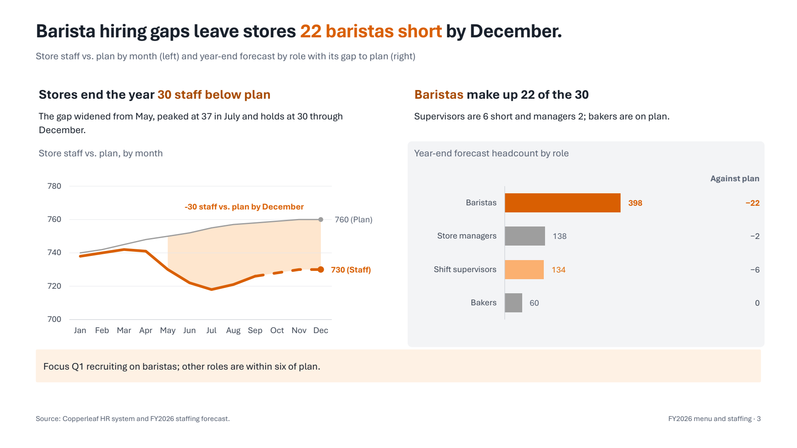
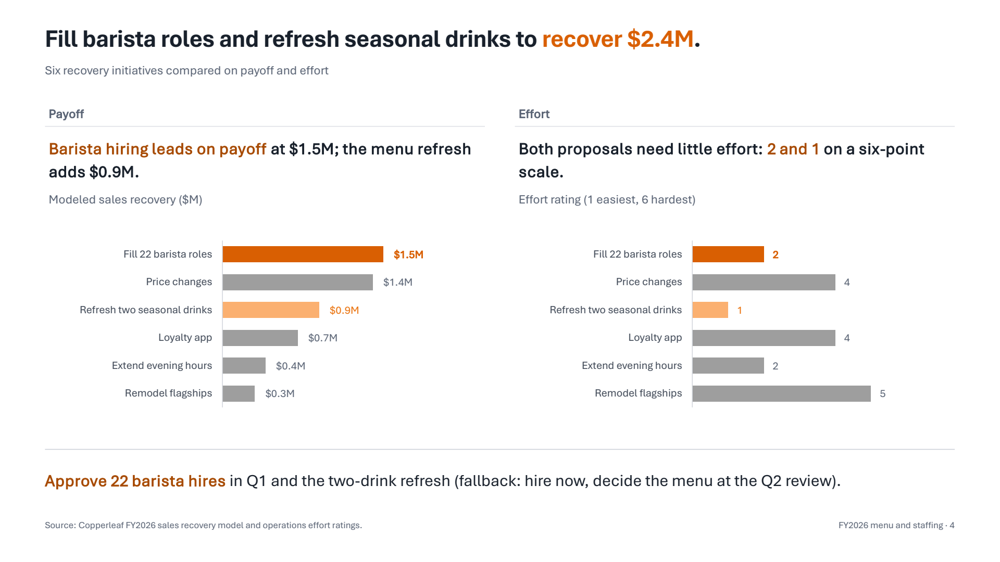
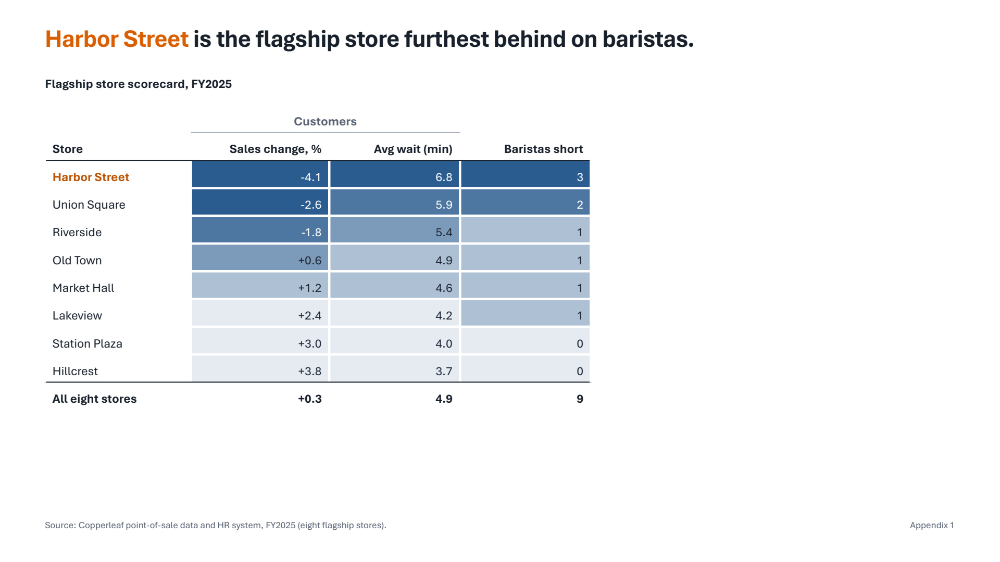
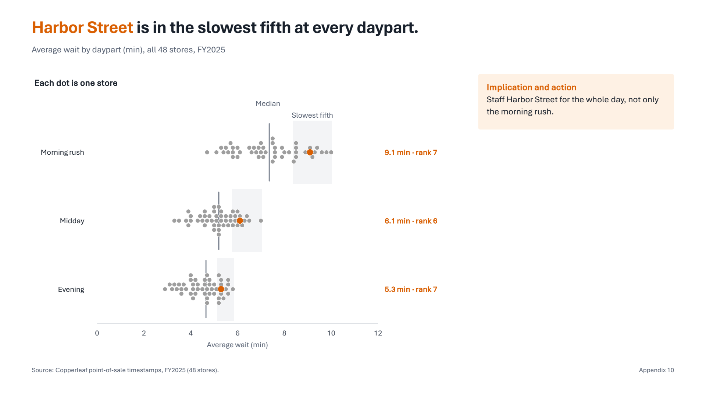
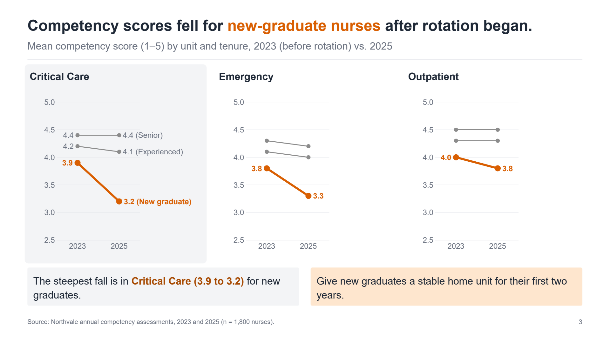
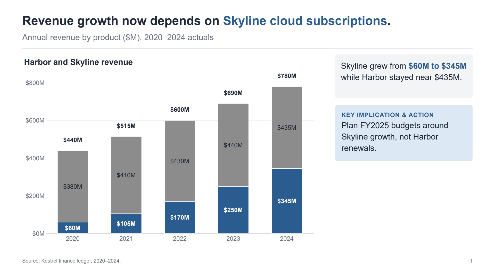
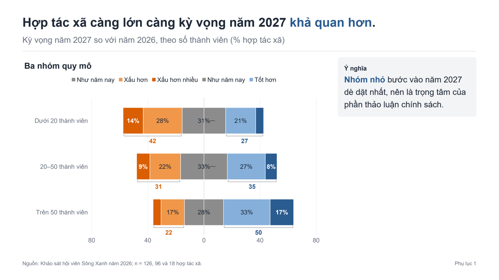
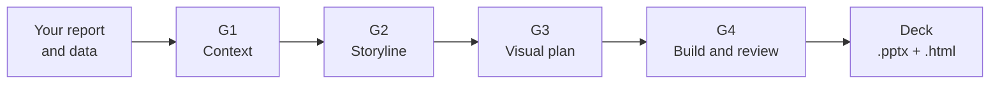

<p align="center">
  
</p>

# Data Story Slide Deck

**From a report and its data to a story-driven slide deck you can still edit.**

[](https://github.com/trongtrd/data-story-slide-deck/actions/workflows/ci.yml) [](https://github.com/trongtrd/data-story-slide-deck/releases) [](#license-and-attribution)

Seven agent skills with installers for Claude Code, Codex, Antigravity and ZCode. They follow the *storytelling with data* (SWD) approach and stop at four checkpoints where you approve the work. The output is a PowerPoint file with **native, editable charts**, plus an HTML version. Every number on a chart is checked against your input files.

> [!NOTE]
> **Pre-release (`v0.1.0-rc1`).** On Windows, adding the Claude Code marketplace straight from GitHub currently fails (use a local clone, below). Not yet tested: the Claude Code install on macOS and Linux, PowerPoint on macOS, projection on a real projector, and Excel's chart-data window. What has been tested is listed in [Status and limitations](./40_plugin/README.md#status-and-limitations).

[Quickstart](#quickstart) · [Why this exists](#why-this-exists) · [Gallery](#gallery) · [How it works](#how-it-works) · [Is this for you?](#is-this-for-you) · [FAQ](#faq) · [Tiếng Việt](./README.vi.md)

---

## Quickstart

You need Python 3.10 or later. Microsoft PowerPoint or LibreOffice is optional; it turns the `.pptx` into QA images. Full details and options are in [`40_plugin/README.md`](./40_plugin/README.md).

### Try it without an agent (about a minute)

```bash
git clone https://github.com/trongtrd/data-story-slide-deck.git
cd data-story-slide-deck
python 40_plugin/install.py --deps-only                  # private Python environment in ~/.data-story-slide-deck
python 40_plugin/scripts/deckctl.py smoke --keep ./demo  # builds the bundled two-slide example
```

You get `demo/output/presentation.pptx` (open it and click a chart: the data is editable) and an HTML version. With PowerPoint or LibreOffice installed, `demo/renders/` also holds QA images of the real `.pptx`. The example is synthetic and skips the approval checkpoints; your own decks go through them.

### Use it with your agent

| Agent | Install |
|---|---|
| **Claude Code** | `claude plugin marketplace add trongtrd/data-story-slide-deck`, then `claude plugin install data-story-slide-deck@data-story-slide-deck`. On Windows the first command currently stops with `EPERM`; from a clone, run `claude plugin marketplace add ./data-story-slide-deck` instead. |
| **Codex** | `codex plugin marketplace add trongtrd/data-story-slide-deck`, then `codex plugin add data-story-slide-deck@data-story-slide-deck`; or `python 40_plugin/install.py` from a clone. |
| **Antigravity** | `python 40_plugin/install.py` from a clone. |
| **ZCode** | `python 40_plugin/install.py --target zcode` from a clone. |

The installer creates a private environment in `~/.data-story-slide-deck`, copies the skills where each agent looks for them, and runs a smoke build; `--uninstall` removes only what it created. With the plugin routes, the skills tell you on first use if the Python environment is missing and how to create it.

Then put your report and data in one folder and ask in plain language:

> Use the deck-orchestrator skill on ./q3-staffing. The staffing report and the headcount spreadsheet are in it. The deck is for the operations committee, which must approve a hiring budget.

> Dùng skill deck-orchestrator cho thư mục ./khao-sat-hop-tac-xa. Báo cáo khảo sát và file số liệu nằm trong đó. Bộ slide trình ban giám đốc để quyết định có mở rộng chương trình hay không.

---

## Why this exists

Ask an agent for a deck and you usually get bullet text on a template, a picture of a chart you cannot edit, or numbers that drift away from the source. This suite takes a different route.

| | |
|---|---|
| **Charts you can still edit** | Native PowerPoint charts with their data inside: restyle them, change a value and the bars move. In PowerPoint 16 on Windows, 37 of 37 charts survived open, edit, save and reopen. |
| **Numbers that trace to your files** | Every plotted value points to a cell or a line in your inputs, and the validator compares them before anything is built. |
| **You approve before slides exist** | Four checkpoints: context, storyline, visual plan, then build and review. A later stage refuses to run on an unapproved or changed earlier file. |
| **A story, not a data dump** | The *storytelling with data* approach: one takeaway title per slide, titles that read as the story on their own, grey context with one focal colour. |
| **Checks that are code, not opinion** | `validate` and `qa` print their verdict. With PowerPoint on Windows, every text frame is measured for clipped and overlapping text. |
| **What the checks do not catch** | Whether the story is right for your audience, labels inside charts, images, and anything on PowerPoint for Mac. You review the deck at G4. |

You get `output/presentation.pptx`, an HTML version, the approval records (`context_brief.md`, `storyline.md`, `slide_spec.yaml`, `review_report_g4.md`) and QA images rendered from the real `.pptx`.

---

## Gallery

These slides come from the benchmark decks in [`50_evals/runs/`](./50_evals/runs/). Their scenarios, companies and numbers are invented. The Editorial showcase is rendered in PowerPoint; the other benchmarks are rendered in LibreOffice so that CI compares like with like on every operating system.

<table>
  <tr>
    <td width="50%"><br><b>Payoff and effort side by side</b>, with the decision</td>
    <td width="50%"><br><b>Heatmap table</b></td>
  </tr>
  <tr>
    <td width="50%"><br><b>Strip plot</b>: every store as a dot</td>
    <td width="50%"><br><b>Small multiples</b> on a shared scale</td>
  </tr>
  <tr>
    <td width="50%"><br><b>Stacked bars</b> in the Blue colour kit</td>
    <td width="50%"><br><b>Vietnamese deck</b>: diverging stacks with side totals</td>
  </tr>
</table>

---

## How it works



| Gate | What you approve | File |
|---|---|---|
| **G1 Context** | Who decides, what they must do, the one-sentence Big Idea | `context_brief.md` |
| **G2 Storyline** | The narrative arc and one takeaway title per slide | `storyline.md` |
| **G3 Visual plan** | 2–3 chart options per slide, with what each shows and hides | visual plan in `storyline.md`, plus a draft `slide_spec.yaml` |
| **G4 Build and review** | The deck compiled from `slide_spec.yaml`, rendered, reviewed and given a finish pass, then your decision | `output/`, `renders/` and `review_report_g4.md` |

Four principles run through every stage:

1. **You decide; the agent drafts.** The agent never invents audience context. It asks you, at most four questions per round, each with a recommended answer.
2. **Process before pixels.** A later stage refuses to run on an unapproved or changed earlier file.
3. **Editable output.** Charts are native PowerPoint charts, not pictures.
4. **Works on any computer.** System fonts (Aptos, with Arial as the fallback) and five colour kits tested for colour blindness, greyscale print and projectors. Brand themes and custom fonts are left to you.

The seven skills: `deck-orchestrator` (entry point), `deck-context-griller` (G1), `deck-storyline-builder` (G2), `deck-visual-planner` (G3), `deck-builder` (compiles and renders), `deck-reviewer` and `deck-finisher` (G4). Each skill's job is in [`40_plugin/README.md`](./40_plugin/README.md).

---

## Is this for you?

| Your situation | Use it? | Why |
|---|---|---|
| You have a report and its data and need a deck for a decision or a pre-read | Yes | This is the core use. |
| You want charts you can still edit in PowerPoint | Yes | Charts are native, with their data inside. |
| You want a person to approve the context, story and chart choices before slides exist | Yes | Four checkpoints; later stages refuse to skip them. |
| Your deck is in English or Vietnamese | Yes | Title and typography rules exist for these two languages. |
| You want a branded theme, custom fonts or decorative colour | Not included | The plugin ships one calm design system and five colour kits; brand fine-tuning after delivery is yours. |
| You have numbers but no source files to trace them to | No | Every plotted value must point to a cell or a line in your inputs. |
| You want a finished deck with no review | No | The agent drafts; you review at G4. |
| You need HTML as the primary output | Not yet | HTML is secondary and its typography is checked less strictly. |

---

## Evaluation

Six benchmark decks, in English and Vietnamese, are scored on a 100-point rubric. Only machine-verified checks score, and a full score means the deck is mechanically sound; whether it tells the right story is still your call. The benchmarks, the rubric, the agent runs so far and the commands to run the checks are in [`50_evals/README.md`](./50_evals/README.md).

---

## FAQ

<details>
<summary><b>Does the deck open in Keynote or Google Slides?</b></summary>

The charts are standard PowerPoint charts. Tests so far use PowerPoint 16 on Windows and LibreOffice; Keynote and Google Slides are not tested.
</details>

<details>
<summary><b>Do I need an API key or an internet connection?</b></summary>

No. The skills run inside the agent you already use, and the Python scripts run locally.
</details>

<details>
<summary><b>Can I use my brand colours and fonts?</b></summary>

Brand colours, yes: say so at G1 and the agent maps one of them to the focal colour and checks its contrast. A brand font works if it is installed on every computer that opens the deck. A brand `.potx` template is not supported.
</details>

<details>
<summary><b>Why does the agent ask me so many questions?</b></summary>

It never invents who the audience is or what they must decide. It asks at most four questions per round, each with a recommended answer, so you can accept the recommendations and move on.
</details>

<details>
<summary><b>Can I skip a checkpoint?</b></summary>

No. A later stage refuses to run until the earlier file is approved, and the deck is finished only when you accept it at G4.
</details>

---

## Repository structure

```text
data-story-slide-deck/
├── README.md, AGENTS.md    # for people / for AI agents
├── 00_admin/               # status, roadmap, backlog, decisions, conventions
├── 10_sources/SOURCES.md   # sources studied (notes stay private)
├── 20_knowledge/           # 87 knowledge cards the skills apply
├── 30_design/              # workflow and artifact schemas
├── 40_plugin/              # the product: skills, scripts, installer
└── 50_evals/               # benchmarks, rubric, and test scripts
```

Edit `20_knowledge/` and `30_design/`, not their copies in `40_plugin/`; `50_evals/scripts/sync_plugin_resources.py` updates the copies. **AI coding agents working on this repository start at [`AGENTS.md`](./AGENTS.md).**

---

## License and attribution

Code is Apache-2.0 ([`LICENSE`](./LICENSE)). Knowledge cards, skills, contracts, documentation and examples are CC BY 4.0 ([`LICENSE-CONTENT`](./LICENSE-CONTENT)).

The approach builds on the books, posts and *SWD + AI Primer* by **Cole Nussbaumer Knaflic** and the **storytelling with data** team ([storytellingwithdata.com](https://www.storytellingwithdata.com/)), with secondary sources credited in [`NOTICE`](./NOTICE). The cards and skills are written in this project's own words; no source text, images or PDFs are distributed. This project is not affiliated with or endorsed by storytelling with data.
