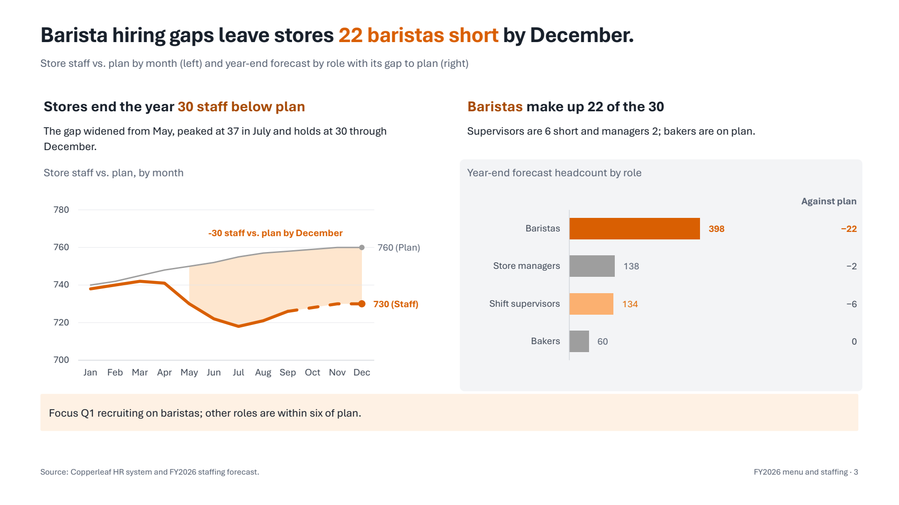

<p align="center">
  
</p>

# Data Story Slide Deck

**Từ báo cáo và số liệu thành bộ slide kể chuyện bằng dữ liệu, vẫn sửa được.**

[English](./README.md) · Bản tiếng Việt này rút gọn; chi tiết đầy đủ nằm ở bản tiếng Anh.

Bảy skill cho agent (Claude Code, Codex, Antigravity, ZCode) theo cách làm *storytelling with data* (SWD). Agent dừng ở bốn điểm kiểm tra để bạn duyệt. Kết quả là file PowerPoint với **biểu đồ gốc, sửa được dữ liệu**, kèm bản HTML. Mọi con số trên biểu đồ đều được đối chiếu với file đầu vào của bạn.

> [!NOTE]
> **Bản pre-release (`v0.1.0-rc1`).** Trên Windows, lệnh thêm marketplace của Claude Code thẳng từ GitHub hiện bị lỗi (dùng bản clone, xem bên dưới). Những gì đã và chưa kiểm thử nằm ở [Status and limitations](./40_plugin/README.md#status-and-limitations).

## Thử ngay, không cần agent (khoảng một phút)

Cần Python 3.10 trở lên. PowerPoint hoặc LibreOffice là tùy chọn, dùng để xuất ảnh kiểm tra từ file `.pptx`.

```bash
git clone https://github.com/trongtrd/data-story-slide-deck.git
cd data-story-slide-deck
python 40_plugin/install.py --deps-only                  # môi trường Python riêng trong ~/.data-story-slide-deck
python 40_plugin/scripts/deckctl.py smoke --keep ./demo  # dựng deck mẫu hai slide
```

Bạn nhận được `demo/output/presentation.pptx` (mở ra, bấm vào biểu đồ: dữ liệu sửa được) và bản HTML. Nếu máy có PowerPoint hoặc LibreOffice, `demo/renders/` có thêm ảnh kiểm tra của chính file `.pptx`.

## Dùng với agent

| Agent | Cài đặt |
|---|---|
| **Claude Code** | `claude plugin marketplace add trongtrd/data-story-slide-deck`, rồi `claude plugin install data-story-slide-deck@data-story-slide-deck`. Trên Windows lệnh đầu hiện báo `EPERM`; khi đó clone repo và chạy `claude plugin marketplace add ./data-story-slide-deck`. |
| **Codex** | `codex plugin marketplace add trongtrd/data-story-slide-deck`, rồi `codex plugin add data-story-slide-deck@data-story-slide-deck`; hoặc `python 40_plugin/install.py` từ bản clone. |
| **Antigravity** | `python 40_plugin/install.py` từ bản clone. |
| **ZCode** | `python 40_plugin/install.py --target zcode` từ bản clone. |

Sau đó để báo cáo và số liệu vào một thư mục rồi nói với agent, ví dụ:

> Dùng skill deck-orchestrator cho thư mục ./khao-sat-hop-tac-xa. Báo cáo khảo sát và file số liệu nằm trong đó. Bộ slide trình ban giám đốc để quyết định có mở rộng chương trình hay không.

Bộ quy tắc tiêu đề và chữ có riêng cho tiếng Việt: tiêu đề 8–16 âm tiết, không tách từ ghép khi xuống dòng.

## Bốn điểm bạn duyệt

| Cổng | Bạn duyệt gì | File |
|---|---|---|
| **G1 Bối cảnh** | Ai quyết định, họ cần làm gì, Big Idea một câu | `context_brief.md` |
| **G2 Mạch chuyện** | Mạch kể và một tiêu đề kết luận cho mỗi slide | `storyline.md` |
| **G3 Kế hoạch hình** | 2–3 phương án biểu đồ mỗi slide, mỗi phương án cho thấy gì và che gì | kế hoạch trong `storyline.md` |
| **G4 Dựng và soát** | Deck đã dựng, đã render và soát, rồi đến quyết định của bạn | `output/`, `renders/`, `review_report_g4.md` |

Agent không tự bịa bối cảnh: mỗi vòng hỏi tối đa bốn câu, câu nào cũng có đáp án khuyến nghị để bạn chọn nhanh. Bước sau không chạy khi bước trước chưa được duyệt hoặc đã bị sửa.

Phần còn lại (gallery, đánh giá, cấu trúc repo, giấy phép) xem ở [bản tiếng Anh](./README.md).

## Giấy phép

Code theo Apache-2.0, nội dung (thẻ kiến thức, skill, tài liệu) theo CC BY 4.0. Dự án dựa trên cách làm của **storytelling with data** nhưng không liên kết và không được storytelling with data bảo trợ. Chi tiết ở [`NOTICE`](./NOTICE).
